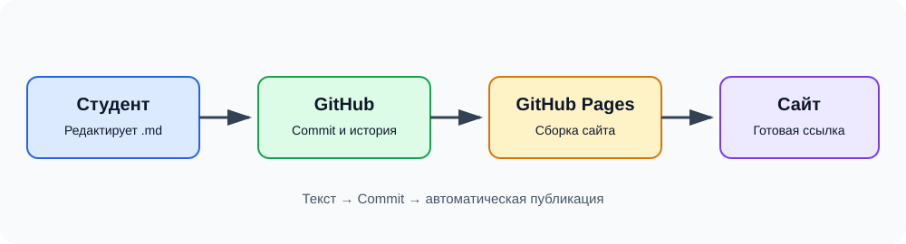

# Автоматизация разработки технической документации

**Учебный проект по практической работе 3.4**

Этот сайт демонстрирует принцип Docs-as-Code: документация хранится в репозитории, изменения фиксируются в истории Git, а опубликованная страница обновляется после внесения изменений.

## Разделы
- [Введение](docs/01_intro.md)
- [Описание API](docs/02_api.md)
- [Отчёт о работе](docs/03_report.md)

## Схема процесса

